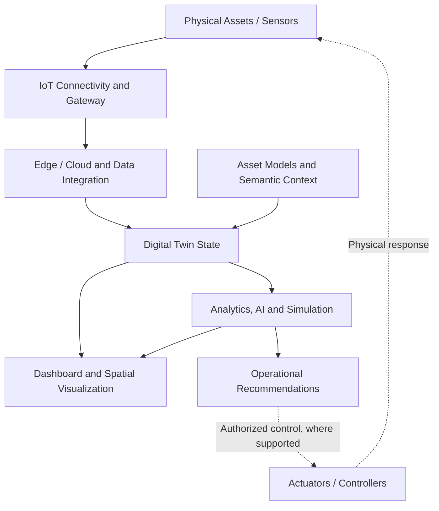

# Internet of Things (TIC06)

**Universitas Bunda Mulia (UBM) | Faculty of Technology and Design**  
Undergraduate Informatics and Data Science Programs

## About this repository

This repository serves as a learning resource for **TIC06 – Internet of Things (IoT)** at Universitas Bunda Mulia. The course introduces fundamental IoT concepts, architectures, components, communication protocols, applications, and the evolution of IoT technology. It combines theoretical foundations with practical system design, simulation, and application development.

The revised curriculum extends conventional IoT engineering with **Digital Twins, Artificial Intelligence of Things (AIoT), edge computing, spatial modeling, and operational analytics**. Students learn how observations from physical devices become contextualized information, how digital representations are updated, and how these systems support operational decisions.

The course emphasizes practical engineering across smart buildings, mining, oil and gas, smart cities, agriculture, energy, transportation, healthcare, and large-scale events.

## Course information

| Item | Details |
| --- | --- |
| Course code | TIC06 |
| Course title | Internet of Things |
| Institution | Universitas Bunda Mulia |
| Faculty | Faculty of Technology and Design |
| Programs | Informatics and Data Science |
| Level | Undergraduate |
| Semester | 7 |
| Credits | 4 SKS (2 theory / 2 practical) |
| Curriculum basis | Revised Semester Learning Plan (RPS), `TIC06_IoT_Digital_Twin_RPS_Revised.xlsx` |

## Course learning outcomes (CPMK)

| Outcome | Description | RPS taxonomy |
| --- | --- | --- |
| CPMK 1 | Explain fundamental IoT concepts, including architectures, components, and communication protocols used in IoT systems. | C2, A2 |
| CPMK 2 | Design and develop simple IoT systems using microcontrollers and various sensors and actuators. | C3, A3 |

The revised course develops these outcomes through applications involving connected assets, telemetry, Digital Twin models, data analysis, and simulation.

## Course roadmap

Each row follows a pair of sessions in the revised RPS. The Digital Twin activities are planned learning activities, not a claim that every notebook has already been published in this repository.

| Sessions | Core topic | Digital Twin integration and practical focus |
| --- | --- | --- |
| 1–2 | IoT Definitions and Brief History | IoT evolution, infrastructure, standardization, and examples of IoT solving real-world problems. |
| 3–4 | IoT Architecture and Interoperability | Digital Twin foundations, capability levels, physical-to-digital mapping, asset hierarchy, and Smart Building telemetry mapping. |
| 5–6 | Edge Computing and Distributed Intelligence | Edge-to-twin data pipeline, MQTT telemetry, state synchronization, and mining equipment monitoring. |
| 7–8 | IoT Security and Privacy | Risk assessment, AAA, OT/IT security, trust boundaries, and threat modeling for operational Digital Twins. |
| 9–10 | Artificial Intelligence of Things (AIoT) | Edge/cloud AI, anomaly detection, predictive modeling, virtual sensing, and model outputs integrated into twin state. |
| 11–12 | Smart Cities | Spatial context, GIS, 2D/3D visualization, privacy by design, and location-aware IoT assets. |
| 13–14 | Review 1 | Integrating sensing, connectivity, data, Digital Twin models, visualization, and AI; demonstrate a minimal working twin. |
| UTS | Midterm Examination | Individual written examination. |
| 15–16 | Smart Agriculture | Environmental and utility twins; rainfall, water levels, pump states, and mine-water monitoring. |
| 17–18 | Smart Grid | Energy Digital Twins, physics-based models, simulation, load management, and what-if analysis. |
| 19–20 | IoT in Large Scale Events | Wristbands, camera-based crowd monitoring, event streams, spatial analytics, geofencing, and decision support. |
| 21–22 | Smart Homes and Buildings | BACnet/Modbus concepts, data aggregation, semantic models, BIM context, HVAC and occupancy monitoring, and building optimization. |
| 23–24 | Connected Vehicles | Mobile-asset twins, GPS telemetry, fleet monitoring, routing, and logistics simulation. |
| 25–26 | IoT in Health | Wearables, worker safety, contextual risk alerts, and operationalization of Digital Twins. |
| 27–28 | Review 2 | Consolidation of concepts, applications, and system design. |
| UAS | Final Examination | Group take-home IoT solution design, analysis, and video or simulation. |

## Engineering approach

The course connects the main components of an IoT-enabled Digital Twin through an end-to-end architecture:



IoT provides observations from the physical world. Asset and semantic models describe what the observations mean and how entities relate. A Digital Twin integrates relevant models with changing operational state. Analytics and simulation can then support monitoring, prediction, and decisions. A 3D model or sensor dashboard alone is not necessarily a Digital Twin. Closed-loop control is an optional capability and requires appropriate security, permissions, and safety checks.

## Hands-on learning resources

The repository is intended to organize lecture slides, Google Colab notebooks, sample datasets, technical illustrations, case studies, and practical exercises as the course develops.

### IoT in Large Scale Events: Hajj Crowd Digital Twin

A learning prototype for monitoring simulated pilgrims using virtual wristbands, MQTT messaging concepts, geospatial tracking, zone occupancy, and alerts. Students examine how incoming telemetry updates device state and how spatial context supports crowd monitoring.

The prototype uses synthetic data and simplified monitoring zones. It is not an operational Hajj safety system. MQTT and any non-MQTT fallback must be distinguished when running the exercise.

### Smart Homes and Buildings: Smart Building Digital Twin

A Google Colab practical simulates a three-floor building with six rooms and 24 virtual IoT points. Students read CSV data, decode simulated BACnet/Modbus readings, aggregate by room and timestamp, apply semantic context, reconstruct Digital Twin state, and visualize building conditions, alerts, and what-if energy estimates.

Notebook: `Smart_Building_IoT_Digital_Twin_Read_CSV.ipynb`

| Dataset | Purpose |
| --- | --- |
| `building_rooms.csv` | Simplified BIM: room identity, floor, geometry, and capacity. |
| `building_devices.csv` | Device registry, room mapping, measurements, protocols, and scaling. |
| `iot_sensor_data.csv` | Synthetic timestamped IoT telemetry. |
| `semantic_relationships.csv` | Explicit relationships among rooms, sensors, and HVAC points. |
| `digital_twin_history.csv` | Reference Digital Twin history for validation. |

The notebook only reads existing CSV files. It reconstructs state in memory and compares results against the reference history. BACnet and Modbus are simulated through data mapping, not actual network exchanges. The BIM representation is simplified tabular geometry, not a full IFC model.

## Suggested repository organization

The following structure is a suggested convention, not an inventory of files already uploaded to GitHub.

```text
IoT-UBM/
├── README.md
├── syllabus/
├── lecture-slides/
├── notebooks/
│   ├── large-scale-events/
│   └── smart-building/
├── datasets/
├── illustrations/
├── case-studies/
└── assignments/
```

## Getting started

1. Locate the notebook and its accompanying datasets in the relevant topic folder.
2. Open the `.ipynb` file in [Google Colab](https://colab.research.google.com/).
3. For the Smart Building practical, upload all five CSV files into the Colab Files panel (`/content`).
4. Select **Runtime → Run all**, or execute each cell sequentially and inspect its output.
5. Review the code, sample readings, charts, and validation results. Change parameters only where the notebook or lecturer instructs you to do so.

Most simulation exercises use Python, Pandas, and Matplotlib. Some activities may require MQTT client libraries, a broker, or optional microcontroller hardware depending on the exercise. Consult each notebook for its specific requirements.

## Assessment

| Component | Weight |
| --- | ---: |
| Practical work | 30% |
| Midterm examination (UTS) | 30% |
| Final examination (UAS) | 40% |
| **Total** | **100%** |

The revised RPS specifies an individual written midterm and a group take-home final. The final assessment focuses on analyzing a real-world problem, designing a suitable IoT solution, and demonstrating the proposed solution through a video or simulation. Students should follow the lecturer's current instructions for submissions, deadlines, and assessment details.

## References

### Primary textbook

1. Ziegler, S., Rado, R., Quesada Rodriguez, A., & Matheu Garcia, S. N. (2024). *Springer Handbook of Internet of Things*. Springer.

### Supporting textbooks listed in the revised RPS

2. Veneri, G., & Capasso, A. (2024). *Hands-On Industrial Internet of Things* (2nd ed.). Packt Publishing.
3. Biegel, G. (2026). *Digital Twins in Action* (MEAP Version 7, as listed in the RPS). Manning Publications.
4. Nelson, H. (2026). *AI Powered Digital Twins: A Guide for Humans, Engineers, and Enterprises*. Wiley.

### Additional learning resources

- [Google Colab](https://colab.research.google.com/)
- [Pandas documentation](https://pandas.pydata.org/docs/)
- [Matplotlib documentation](https://matplotlib.org/stable/)
- [MQTT](https://mqtt.org/)
- [BACnet](https://bacnet.org/)
- [Modbus Organization](https://www.modbus.org/)
- [FIWARE](https://www.fiware.org/)
- [Brick Schema](https://brickschema.org/)

## Academic integrity and responsible engineering

Use the materials to understand, reproduce, and extend the experiments. Identify assumptions, document data sources, distinguish simulations from real measurements, and report limitations. Do not use synthetic results as evidence of real-world performance. Protect personal and operational data, and do not connect experimental control code to real equipment without authorization and appropriate safety validation.

Third-party textbooks, figures, datasets, and software remain subject to their respective rights and licenses. No repository-wide license is asserted here.

---

**TIC06 – Internet of Things**  
Faculty of Technology and Design | Universitas Bunda Mulia
